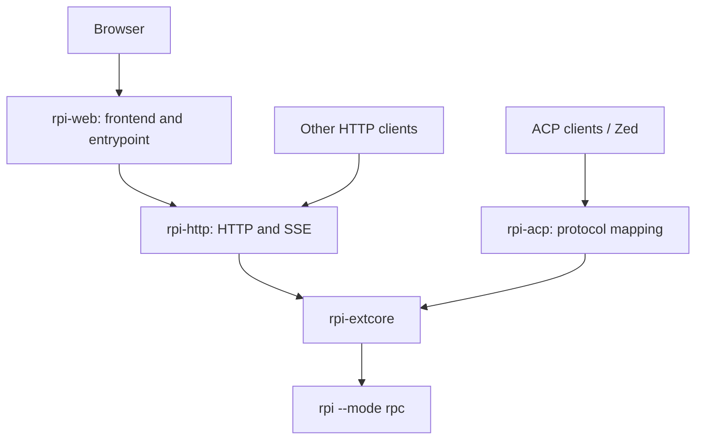

# Shared extension backend

Implemented on `feature–1024`, based on main at `450587a`. This change extracts existing ACP/Web capabilities into `rpi-extcore` and makes the protocol adapters depend on that core. The native rpi host and plugin ABI are unchanged.

## Ownership

- **rpi-extcore** owns native RPC children, request correlation, runs, cancellation, event projection/replay, transcript snapshots, native history traversal, question answer validation, workspace/project services, registry metadata and timings. It exposes ordinary Rust APIs and neutral outcomes, without Axum responses, ACP updates or plugin entrypoints.
- **rpi-http** owns extraction/serialization, HTTP status mapping, cookie authentication, Host/Origin checks, SSE encoding and listener lifecycle. It can embed an existing core instance or run without a frontend.
- **rpi-acp** owns ACP JSON-RPC, capabilities, content conversion, stopReason mapping, tool/diff/plan formatting, client request tasks and Zed/terminal-auth integration. Client request tasks belong here because they manage ACP transport resources; native run, text and answer semantics belong to the core.
- **rpi-web** owns Vite/React resources, `build.rs` embedding, frontend routes, Web configuration and native-extension/standalone entrypoints. The extracted core and HTTP code link into its existing extension library; users do not install additional extension libraries.

## Reusable MCP foundation

`rpi-mcp-adapter -> rpi-mcp-core` is a separate reusable-library boundary:

- **rpi-mcp-core** owns caller-instanced MCP connections, request context,
  subscriptions, delivery-batch lifetimes, transport bounds, cancellation and
  process-tree cleanup. It does not depend on the plugin SDK, ACP, HTTP server
  types or frontend code. MCP Streamable HTTP is an existing client transport,
  not an Axum/service adapter.
- **rpi-mcp-adapter** owns the existing plugin ABI/four tools, SDK context and
  session-environment interpretation, compatibility default runtime, host tool
  result projection, and custom TurnEnd messages. Core returns neutral resource
  updates and retryable batches, not host-role messages.
- Every core runtime owns its registry and queues. Sharing configuration files
  or using identical scope strings does not share connections across instances.
  Share an `Arc<McpRuntime>` deliberately when one service should own them.
- Core denies unsafe code except for its private audited OS process module,
  which owns Windows suspended/headless Job Object setup and Unix process groups.
  ABI-free does not mean all platform FFI is unsafe-free.

This extraction does not yet add an `rpi-extcore -> rpi-mcp-core` dependency or
connect ACP `mcpServers` to native external-tool registration. That integration
remains separate; native process/RPC/run ownership stays in extcore and ACP-only
configuration/capability mappings stay in ACP.

## Preserved behavior

- Keep `--webserver`, `--web`, `--acp` and existing standalone entrypoints.
- Keep `.rpi/web.json`, existing discovery/precedence, environment compatibility and explicit assets overrides.
- Keep `/api/v1` and the existing HTTP/SSE wire formats, including authentication and legacy header/cookie names.
- Keep ACP v1 initialization, capability negotiation, history replay, permissions/questions, model configuration, error categories and Zed registration.
- Keep existing Web and ACP transcript/metadata locations. The native host owns transcripts; supplemental indexes and timings do not replace them.
- Use validated native ready frames in both adapters. Offline peers now advertise the same handshake as the real host.
- Acceptance acknowledges a command; `agent_end` does not complete a run. `agent_settled` determines the outcome. Reconcile cumulative/final text snapshots before responding to clients.
- Subscribe before sending or taking a replay boundary. Preserve request-ID isolation, bounded queues, timeouts, cancellation cleanup and explicit overflow/resync handling.

## Deployment boundary

The dependency graph describes shared code. Separate `rpi --acp`, `rpi --webserver` and `rpi-http` processes still own separate runtime instances. To share live sessions, clients must connect to one service instance. HTTP can embed a caller-owned `Arc<Service>`; sharing JSON files between independent processes is not a live-session transport. Use a single writer per registry.

Remote ACP-to-HTTP attachment and a combined multi-protocol daemon are subsequent deployment features. TCP and other extensions can adopt the core later without changing this dependency direction.

## Verification contract

- Existing ACP unit and native integration checks cover streaming repair, authoritative completion, cancellation, dialog closure/late replies, permission policy, error handling, saved-session branches and plugin lifecycle.
- Existing Web checks cover configuration, embedded/external frontend delivery, authentication, native sessions, startup addresses and restart persistence.
- Core tests retain the moved registry, project, file/Git, timing, request-isolation and cancellation checks.
- HTTP tests prove a Rust caller and an HTTP client mutate the same core instance, preserve error/status mapping, and expose no frontend routes in headless mode.
- The API-only native smoke test covers real-host commands, snapshots/SSE, authentication and durable metadata recovery without model calls.

This branch changes source and documentation only; it does not publish a release.

## Local validation

Validated on 2026-10-24 on Windows x64 with the installed rpi 0.7.1 host:

- `cargo test --workspace --locked` passed, including the existing optional-feature defaults.
- The 138 tests for extcore, HTTP, ACP and Web passed after the review fixes.
- Clippy passed with `-D warnings` for all four affected packages and their targets.
- Native Web startup/configuration/authentication/project/session checks and API-only HTTP smoke checks passed without model calls.
- ACP streaming, restart, permission-policy, plugin lifecycle, native goal/tool continuation and registry-auth checks passed.
- All 13 Open WebUI/Pipe and native UI-adapter tests passed in an isolated Python environment.
- All 21 release-distribution tooling tests passed. No publication was performed.

Review follow-up on 2026-10-24:

- Resolve a relative HTTP config filename against the launch directory before resolving its JSON paths. CLI filesystem paths are anchored to the launch directory; bare executable names retain PATH lookup. Native smoke checks use a relative config filename and a different child working directory, and verify the actual transcript location.
- Normal exit, forced termination, shutdown timeout and owner drop share idempotent finalization: publish `host_closed` to raw and projected/replay subscribers, clear dialogs, fail pending commands, and persist interrupted tool timings. Serialized cleanup retains ownership of the worker when a shutdown caller is cancelled; termination finalization survives cancellation of its caller.
- Regression tests exercise both cancellation stages, stalled-host shutdown, interrupted timing persistence and repeated cleanup. The native HTTP smoke test also verifies that deleting a live session delivers its terminal SSE event.
- Rechecked ACP streaming/restart, native plugin/goal behavior, all 13 UI-adapter checks and Web configuration plus standalone/extension IPv4/IPv6 startup. The direct native termination probe now receives both close events.
- Linux target checks passed for all extcore/ACP targets. The broader Linux check could not compile the HTTP test dependency `ring` because this Windows environment lacks `x86_64-linux-gnu-gcc`; Linux runtime tests were not run here.
