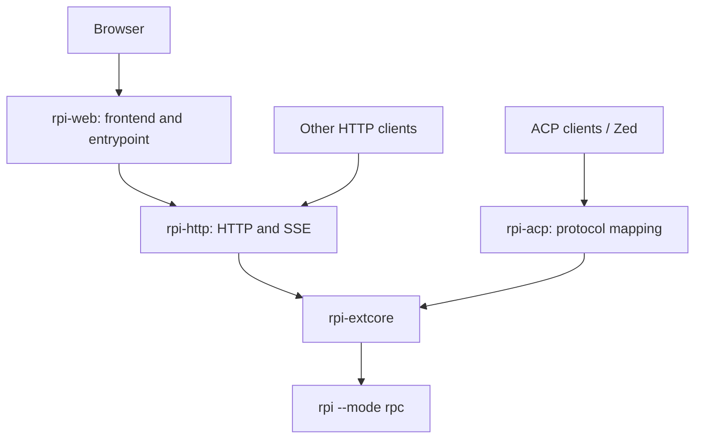

# Shared extension backend

Implemented on `feature–1024`, based on main at `450587a`. This change extracts existing ACP/Web capabilities into `rpi-extcore` and makes the protocol adapters depend on that core. The native rpi host and plugin ABI are unchanged.

## Ownership

- **rpi-extcore** owns native RPC children, request correlation, runs, cancellation, event projection/replay, transcript snapshots, native history traversal, question answer validation, workspace/project services, registry metadata and timings. It exposes ordinary Rust APIs and neutral outcomes, without Axum responses, ACP updates or plugin entrypoints.
- **rpi-http** owns extraction/serialization, HTTP status mapping, cookie authentication, Host/Origin checks, SSE encoding and listener lifecycle. It can embed an existing core instance or run without a frontend.
- **rpi-acp** owns ACP JSON-RPC, capabilities, content conversion, stopReason mapping, tool/diff/plan formatting, client request tasks and Zed/terminal-auth integration. Client request tasks belong here because they manage ACP transport resources; native run, text and answer semantics belong to the core.
- **rpi-web** owns Vite/React resources, `build.rs` embedding, frontend routes, Web configuration and native-extension/standalone entrypoints. The extracted core and HTTP code link into its existing extension library; users do not install additional extension libraries.

## Reusable MCP foundation

`rpi-mcp-adapter -> rpi-mcp-core` remains the reusable-library boundary;
`rpi-extcore -> rpi-mcp-core` also supports session-owned stdio and Streamable HTTP tools:

- **rpi-mcp-core** owns caller-instanced MCP connections, request context,
  subscriptions, delivery-batch lifetimes, transport bounds, cancellation and
  process-tree cleanup. It does not depend on the plugin SDK, ACP, HTTP server
  types or frontend code. MCP Streamable HTTP is an existing client transport,
  not an Axum/service adapter.
- **rpi-mcp-adapter** owns the existing plugin ABI/four tools, SDK context and
  session-environment interpretation, compatibility default runtime, host tool
  result projection, and custom TurnEnd messages. Core returns neutral resource
  updates and retryable batches, not host-role messages.
- Every core runtime owns its registry and queues. Sharing configuration files
  or using identical scope strings does not share connections across instances.
  Share an `Arc<McpRuntime>` deliberately when one service should own them.
- Core denies unsafe code except for its private audited OS process module,
  which owns Windows suspended/headless Job Object setup and Unix process groups.
  ABI-free does not mean all platform FFI is unsafe-free.

### Session-owned MCP tools integration

`rpi-extcore::external_tools::ToolServer::{Stdio, Http}` wraps `StdioToolServer`
and `HttpToolServer { name, url, headers }` without ACP types.
`HostSession::configure_tools(servers, cwd, scope)` is protocol-neutral;
`configure_stdio_tools` remains a compatibility wrapper.
Extcore owns one caller-instanced MCP runtime per configured native session,
discovery, atomic native catalog registration, request routing, deadlines,
cancellation and child cleanup. ACP strictly parses `mcpServers` on
`session/new`, `session/load` and `session/resume`, resolves relative command
paths against the explicit session cwd, checks native session identity and maps
the configuration into that API. It does not own a parallel tool engine.
`mcpCapabilities.http` is true and `sse` false: Streamable HTTP tools use POST
JSON or POST response-body SSE, not legacy SSE or background GET streams.
Core owns `ConfiguredHttp` / `discover_http` / `call_http` and the matching stdio
APIs, with frozen configuration and live-generation admission. ACP only maps
explicit `type: "http"`, `name`, absolute HTTP(S) `url` and required `headers`
array (`[]` allowed); stdio remains implicit. Headers support static
Authorization/custom values, are lowercased, and reject case-insensitive
duplicates, controls, reserved transport/framing and hop-by-hop names. URLs
reject userinfo, fragments, surrounding whitespace and controls; query strings
are opaque and potentially secret. See the
[core HTTP policy](../../packages/rpi-mcp-core/README.md#in-memory-streamable-http-targets-tools-only).
Typed HTTP disables ambient proxies and redirects; legacy MCP behavior remains
unchanged. This trusted-client outbound authority permits local/private HTTP,
not an SSRF sandbox; recommend HTTPS, particularly for credentials.

Nonempty configuration requires native commands `configure_external_tools` and
`external_tool_response`, and events `external_tool_request` and
`external_tool_request_closed`. Extcore checks these capabilities before spawning
MCP children or contacting HTTP endpoints. Empty configuration remains compatible with older hosts. Native
rpi owns model-visible tool registration, schema validation, tool-call provenance,
result validation/projection and persisted history. Extcore forwards raw MCP
results as `externalToolResult` (including text/image metadata, `isError` and
`structuredContent`) for native validation; unsupported content produces an
explicit error, never silent removal. ACP separately projects ordinary native
tool events/history into ACP updates; its presentation is not native result
projection and does not create another transcript.

Omission on a live session retains configuration; explicit identical configuration
is allowed, but changed configuration is rejected before history replay. A fresh
load/resume requires the client to reprovide configuration and credentials.
Commands, arguments, environment secrets, HTTP URLs/opaque queries and headers
are not persisted in transcripts, registry metadata or a parallel database.
Live equality includes cwd/scope and lowercased headers after validation;
identical config does not requery or revive failed admission. Session scope isolates runtime keys;
export names are deterministic 64-character `mcp_` plus 60 SHA-256 hex digits of
the length-delimited server/tool tuple, not secrets or ambient global identities.

ACP configuration is bounded to 16 servers / 256 KiB encoded configuration.
The session catalog is bounded to 128 tools / 256 KiB, discovery to 30 seconds,
calls to 45 seconds, active requests and the reliable reader queue to 64, and
native outcome frames to 1 MiB. Native request closure and cancellation suppress
queued late responses; overflow fails closed. Cancelled calls are never replayed
or automatically reconnected: the target requires explicit fresh discovery.
Transport/RPC failure or HTTP 404 likewise retires the admitted connection;
`call_http` never initializes, requeries tools or replays. `isError` remains a
valid MCP result. HTTP cancellation notification (200 ms) and session DELETE
(1 second) are best-effort per-connection request timeouts, not a global hard
shutdown deadline, guaranteed server cleanup or undo of remote tool side effects.
Shutdown/owner drop cancels the runtime, and a retained cleanup supervisor joins
workers and terminates child trees within the documented OS/I/O limitations.

This path requires a supporting native build, not merely a newer adapter. It
adds no MCP resources, prompts, sampling, OAuth, legacy SSE/GET streams, plugin
activation, remote attachment or shared multi-protocol service. Existing MCP
adapter APIs retain their separate transport/resource behavior. Native transcript
authority and the neutral core/adapter boundary are unchanged; this does not
change the native host or Web implementation.

### MCP verification boundary

The three-OS MCP workflow runs default tests/checks for MCP core, adapter,
extcore, ACP, HTTP and Web Rust packages, explicit core `configured_http_tests`,
and the feature-gated `rpi-extcore/tests/{mcp_stdio_bridge,mcp_http_bridge}.rs`
using `test-support`. The stdio fixture uses real MCP shell children; HTTP uses
loopback peers. Both use an in-memory native peer, not a real-native smoke test.
ACP parser/protocol and extcore host tests cover strict configuration, old-host
compatibility, identity/capability gates, atomic registration, cancellation,
result bounds and ownership. CI retains core/adapter packaging (with the local
core path patch); only strict MCP core Clippy is a passing gate, not a claim
that existing extcore/adapter strict baselines pass.

Real-native ACP-to-MCP validation is a separate Windows Python harness,
`packages/rpi-acp/tests/mcp_stdio_native.py --help`, with required binary/build
provenance inputs and isolated local fixtures, not real credentials. Its retained
`results.json`, provenance, wire logs, native JSONL and PID audit are execution
evidence; neither source coverage nor CI configuration alone establishes a
successful native smoke run.

The new `packages/rpi-acp/tests/mcp_http_native.py --help` Windows proof requires
explicit bridge/native paths, SHA hashes, build marker and native verification
provenance; it uses a new evidence directory under the stage6 diagnostics root.
It is deliberately excluded from fixture-only CI without those prerequisites.
Inspect the recorded results and complete source manifest; a passing Windows
run does not qualify an installed extension, Unix native execution, TLS or
remote resource reclamation.

Nonempty-MCP fresh restore preflight uses extcore's neutral, bounded native v4
header metadata (64 KiB, exact ID, no messages). ACP rejects differing existing
recorded/requested canonical workspaces before either child spawns; empty or
missing recorded directories retain native launch-cwd fallback. Configuration
is never silently rebased or persisted. No-MCP restores retain compatibility.
As with other filesystem reads, metadata/canonicalization/open are separate
operations, not a hostile concurrent-filesystem guarantee.

## Preserved behavior

- Keep `--webserver`, `--web`, `--acp` and existing standalone entrypoints.
- Keep `.rpi/web.json`, existing discovery/precedence, environment compatibility and explicit assets overrides.
- Keep `/api/v1` and the existing HTTP/SSE wire formats, including authentication and legacy header/cookie names.
- Keep ACP v1 initialization, capability negotiation, history replay, permissions/questions, model configuration, error categories and Zed registration.
- Keep existing Web and ACP transcript/metadata locations. The native host owns transcripts; supplemental indexes and timings do not replace them.
- Use validated native ready frames in both adapters. Offline peers now advertise the same handshake as the real host.
- Acceptance acknowledges a command; `agent_end` does not complete a run. `agent_settled` determines the outcome. Reconcile cumulative/final text snapshots before responding to clients.
- Subscribe before sending or taking a replay boundary. Preserve request-ID isolation, bounded queues, timeouts, cancellation cleanup and explicit overflow/resync handling.

## Deployment boundary

The dependency graph describes shared code. Separate `rpi --acp`, `rpi --webserver` and `rpi-http` processes still own separate runtime instances. To share live sessions, clients must connect to one service instance. HTTP can embed a caller-owned `Arc<Service>`; sharing JSON files between independent processes is not a live-session transport. Use a single writer per registry.

Remote ACP-to-HTTP attachment and a combined multi-protocol daemon are subsequent deployment features. TCP and other extensions can adopt the core later without changing this dependency direction.

## Verification contract

- Existing ACP unit and native integration checks cover streaming repair, authoritative completion, cancellation, dialog closure/late replies, permission policy, error handling, saved-session branches and plugin lifecycle.
- Existing Web checks cover configuration, embedded/external frontend delivery, authentication, native sessions, startup addresses and restart persistence.
- Core tests retain the moved registry, project, file/Git, timing, request-isolation and cancellation checks.
- HTTP tests prove a Rust caller and an HTTP client mutate the same core instance, preserve error/status mapping, and expose no frontend routes in headless mode.
- The API-only native smoke test covers real-host commands, snapshots/SSE, authentication and durable metadata recovery without model calls.

This branch changes source and documentation only; it does not publish a release.

## Local validation

Validated on 2026-10-24 on Windows x64 with the installed rpi 0.7.1 host:

- `cargo test --workspace --locked` passed, including the existing optional-feature defaults.
- The 138 tests for extcore, HTTP, ACP and Web passed after the review fixes.
- Clippy passed with `-D warnings` for all four affected packages and their targets.
- Native Web startup/configuration/authentication/project/session checks and API-only HTTP smoke checks passed without model calls.
- ACP streaming, restart, permission-policy, plugin lifecycle, native goal/tool continuation and registry-auth checks passed.
- All 13 Open WebUI/Pipe and native UI-adapter tests passed in an isolated Python environment.
- All 21 release-distribution tooling tests passed. No publication was performed.

Review follow-up on 2026-10-24:

- Resolve a relative HTTP config filename against the launch directory before resolving its JSON paths. CLI filesystem paths are anchored to the launch directory; bare executable names retain PATH lookup. Native smoke checks use a relative config filename and a different child working directory, and verify the actual transcript location.
- Normal exit, forced termination, shutdown timeout and owner drop share idempotent finalization: publish `host_closed` to raw and projected/replay subscribers, clear dialogs, fail pending commands, and persist interrupted tool timings. Serialized cleanup retains ownership of the worker when a shutdown caller is cancelled; termination finalization survives cancellation of its caller.
- Regression tests exercise both cancellation stages, stalled-host shutdown, interrupted timing persistence and repeated cleanup. The native HTTP smoke test also verifies that deleting a live session delivers its terminal SSE event.
- Rechecked ACP streaming/restart, native plugin/goal behavior, all 13 UI-adapter checks and Web configuration plus standalone/extension IPv4/IPv6 startup. The direct native termination probe now receives both close events.
- Linux target checks passed for all extcore/ACP targets. The broader Linux check could not compile the HTTP test dependency `ring` because this Windows environment lacks `x86_64-linux-gnu-gcc`; Linux runtime tests were not run here.
